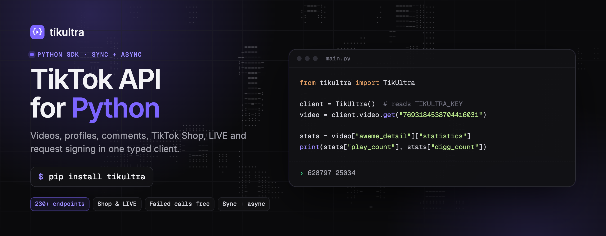

<p align="center">
  <a href="https://tikultra.com/tiktok-api?utm_source=github&utm_medium=readme&utm_campaign=python">
    
  </a>
</p>

<h1 align="center">TikTok API for Python</h1>

<p align="center">
  The Python client for <a href="https://tikultra.com/tiktok-api">Tikultra</a>, an unofficial TikTok API built on TikTok’s native mobile app API.<br>
  Scrape videos, profiles, comments, followers and search, read <b>TikTok Shop</b> and <b>LIVE</b>, download without watermark, and sign mobile requests — sync or async, fully typed.
</p>

<p align="center">
  <a href="https://pypi.org/project/tikultra/"></a>
  <a href="https://pypi.org/project/tikultra/"></a>
  <a href="./LICENSE"></a>
  <a href="https://tikultra.com/docs/python-sdk"></a>
  <a href="https://tikultra.com/status"></a>
</p>

<p align="center">
  <a href="https://tikultra.com/signup?utm_source=github&utm_medium=readme&utm_campaign=python"><b>Get a free API key</b></a> ·
  <a href="https://tikultra.com/docs/python-sdk">Docs</a> ·
  <a href="https://tikultra.com/endpoints">All endpoints</a> ·
  <a href="https://tikultra.com/playground">Playground</a> ·
  <a href="https://github.com/tikultra/tiktok-api-node">Node.js SDK</a>
</p>

---

## Why this TikTok API

- **230+ endpoints on one key** — videos, profiles, posts, comments, followers, search, hashtags, sounds, TikTok Shop, LIVE, Douyin and more.
- **No browsers, proxies or signatures to maintain** — requests go through TikTok’s mobile API from managed devices; you get JSON.
- **Failed calls are free** — you only pay for successful calls. Start with 500 free requests, no card.
- **Sync and async** — `TikUltra` and `AsyncTikUltra` on `httpx`, typed (`py.typed`), Python 3.10+.
- **Built-in pagination, retries and typed errors** — every list returns `{ cursor, has_more }`.

## Install

```bash
pip install tikultra
```

Get a key at [tikultra.com/signup](https://tikultra.com/signup?utm_source=github&utm_medium=readme&utm_campaign=python) and set it:

```bash
export TIKULTRA_KEY="tu_live_..."
```

## Quickstart

```python
from tikultra import TikUltra

client = TikUltra()  # reads TIKULTRA_KEY

video = client.video.get("7693184538704416031")
stats = video["aweme_detail"]["statistics"]
print(stats["play_count"], stats["digg_count"])

profile = client.user.profile("tiktok")
print(profile["user"]["follower_count"])
```

## What you can do

| Task | Method | Guide |
| :--- | :--- | :--- |
| Get a video’s stats, author and sound | `client.video.get(aweme_id \| url=)` | [TikTok scraper API](https://tikultra.com/tiktok-scraper) |
| Scrape a profile and its posts | `client.user.profile()`, `client.user.posts()` | [TikTok profile API](https://tikultra.com/tiktok-profile-api) |
| Export comments and replies | `client.video.comments()`, `client.video.comment_replies()` | [TikTok comment scraper](https://tikultra.com/tiktok-comment-scraper) |
| Export followers and following | `client.user.followers()`, `client.user.followings()` | [TikTok follower scraper](https://tikultra.com/tiktok-follower-scraper) |
| Download without watermark | `client.video.no_watermark()`, `client.video.slideshow()` | [TikTok downloader API](https://tikultra.com/tiktok-downloader-api) |
| Scrape TikTok Shop products, sellers, reviews | `client.shop.search()`, `client.shop.pdp()`, `client.shop.reviews()` | [TikTok Shop scraper](https://tikultra.com/tiktok-shop-scraper) |
| Read LIVE rooms, chat and gifts | `client.live.room()`, `client.live.chat()`, `client.live.gifts()` | [TikTok LIVE API](https://tikultra.com/tiktok-live-api) |
| Track hashtags, sounds and trends | `client.hashtag.get()`, `client.music.charts()`, `client.creator.search_insights()` | [TikTok trends API](https://tikultra.com/tiktok-trends-api) |
| Sign mobile requests (X-Argus, X-Gorgon, X-Ladon) | `client.crypto.sign()` | [TikTok signature API](https://tikultra.com/tiktok-signature-api) |
| Publish to accounts you own | `client.account.upload_video()` | [TikTok posting API](https://tikultra.com/tiktok-posting-api) |

Some endpoints need a paid plan (for example TikTok Shop product pages are on Growth and up); every endpoint’s price and plan is listed at [tikultra.com/endpoints](https://tikultra.com/endpoints).

## Examples

### Export every comment on a video to CSV

```python
import csv
from tikultra import TikUltra

client = TikUltra()
link = "https://www.tiktok.com/@tiktok/video/7693184538704416031"

with open("comments.csv", "w", newline="", encoding="utf-8") as f:
    w = csv.writer(f)
    w.writerow(["comment_id", "author", "likes", "created", "text"])
    for page in client.paginate("/v1/video/comments", params={"url": link}, max_pages=50):
        for c in page["comments"]:
            w.writerow([c["cid"], c["author_unique_id"], c["digg_count"], c["create_time"], c["text"]])
```

### Download a TikTok video without watermark

```python
import httpx
from tikultra import TikUltra

client = TikUltra()
v = client.video.no_watermark(url="https://www.tiktok.com/@tiktok/video/7693184538704416031")
with open(f"{v['aweme_id']}.mp4", "wb") as f:
    f.write(httpx.get(v["play_url_no_watermark"], timeout=120).content)
```

### Scrape TikTok Shop

```python
results = client.shop.search("mechanical keyboard")
for p in results["products"]:
    pdp = client.shop.pdp(p["product_id"])
    reviews = pdp["data"]["reviews"]
    print(p["product_id"], reviews["product_rating"], reviews["review_count"])
```

### Async: many lookups at once

```python
import asyncio
from tikultra import AsyncTikUltra

async def main() -> None:
    async with AsyncTikUltra() as client:
        profiles = await asyncio.gather(*(client.user.profile(u) for u in ["tiktok", "zachking"]))
        for p in profiles:
            print(p["user"]["unique_id"], p["user"]["follower_count"])

asyncio.run(main())
```

### Sign a TikTok mobile request yourself

```python
signed = client.crypto.sign(
    "https://api16-normal-c-useast1a.tiktokv.com/aweme/v2/feed/?aid=1233&count=6",
    method="GET",
)
print(signed["headers"]["x-argus"], signed["headers"]["x-gorgon"], signed["headers"]["x-ladon"])
```

## Pagination, retries and errors

```python
from tikultra import RateLimitError, TikUltraError, UpstreamError

for page in client.paginate("/v1/user/posts", params={"username": "tiktok"}, max_pages=5):
    for post in page["items"]:
        print(post["aweme_id"], post["digg_count"])

try:
    client.video.get("7693184538704416031")
except RateLimitError as err:
    print("retry after", err.retry_after)
except UpstreamError:
    pass  # TikTok-side failure: not billed
except TikUltraError as err:
    print(err.status_code, err.code, err.message)
```

The client retries `429`, `502`, `503` and `504` with backoff (honouring `Retry-After`). Every response exposes `.request_id`, `.credits_cost` and `.credits_remaining`.

## FAQ

**Is this the official TikTok API?** No. TikTok’s official APIs (Research, Display, Content Posting, Shop Partner) are narrow and need approval. Tikultra is an independent, unofficial API for public TikTok data and for accounts you own. [Official vs unofficial, explained](https://tikultra.com/blog/tiktok-api-official-vs-unofficial).

**Do I need proxies or a TikTok account?** No. Public data is read without a TikTok login, and Tikultra picks the region, device and egress.

**Is it free?** You start with 500 free requests and no card; plans start at $49/month. [Pricing](https://tikultra.com/pricing).

**Can AI agents use it?** Yes — there is a hosted MCP server for Claude, Cursor and others: [TikTok MCP server](https://tikultra.com/tiktok-mcp-server).

## Related

- [tiktok-api-node](https://github.com/tikultra/tiktok-api-node) — the same API for Node.js, Bun, Deno and edge runtimes
- [TikTok API guides](https://tikultra.com/tiktok-api) · [Blog](https://tikultra.com/blog) · [llms.txt](https://tikultra.com/llms.txt)

## License

MIT — see [LICENSE](./LICENSE).

Tikultra is independent and is not affiliated with, endorsed or sponsored by TikTok or ByteDance. Use it in line with the law where you operate, TikTok’s terms and the [acceptable use policy](https://tikultra.com/acceptable-use).
