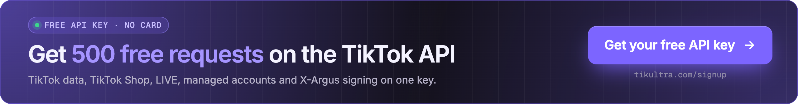
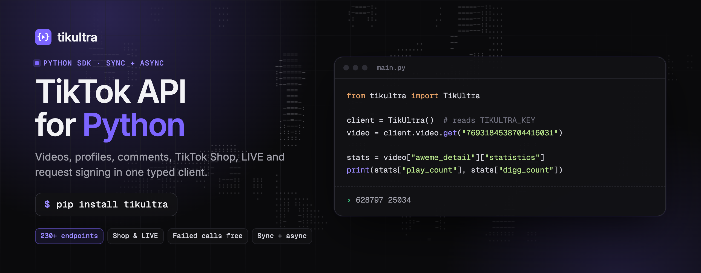

<p align="center">
  <a href="https://tikultra.com/signup?ref=pypi"></a>
</p>

<p align="center">
  <a href="https://tikultra.com/tiktok-api?utm_source=pypi&utm_medium=readme&utm_campaign=python">
    
  </a>
</p>

<h1 align="center">TikTok API for Python</h1>

<p align="center">
  The Python client for <a href="https://tikultra.com/tiktok-api">Tikultra</a>, an unofficial TikTok API built on TikTok’s native mobile app API.<br>
  <b>TikTok Shop API</b>, <b>managed TikTok accounts</b> (login, upload, comments, DMs, LIVE) and scraping for videos, profiles, comments, followers and search — plus native <b>X-Argus</b> signing. Sync or async, fully typed.
</p>

<p align="center">
  <a href="https://pypi.org/project/tikultra/"></a>
  <a href="https://pypi.org/project/tikultra/"></a>
  <a href="https://github.com/xtekky/tikultra/blob/main/LICENSE"></a>
  <a href="https://tikultra.com/docs/python-sdk"></a>
  <a href="https://tikultra.com/status"></a>
</p>

<p align="center">
  <a href="https://tikultra.com/signup?ref=pypi"><b>Get a free API key</b></a> ·
  <a href="https://tikultra.com/docs/python-sdk">Docs</a> ·
  <a href="https://tikultra.com/endpoints">All endpoints</a> ·
  <a href="https://tikultra.com/playground">Playground</a> ·
  <a href="https://github.com/xtekky/tikultra-ts-sdk">Node.js SDK</a>
</p>

> [!TIP]
> **Free API key:** [sign up here](https://tikultra.com/signup?ref=pypi) and get **500 requests, no card**. Plans from $49/month with managed accounts and TikTok Shop; failed calls are never billed. Run `python -m tikultra` after installing to check your setup.

---

## Why this TikTok API

- **Managed TikTok accounts** — sign in, upload, comment, DM and go LIVE on the accounts you own, each on its own isolated device. No other TikTok API offers this.
- **TikTok Shop API** — full product pages (every SKU price, voucher, shipping promise), sellers, reviews, creator showcases, LIVE shopping bags and visual product search.
- **230+ endpoints on one key** — videos, profiles, posts, comments, followers, search, hashtags, sounds, LIVE, Douyin and more.
- **Native mobile signing** — X-Argus, X-Gorgon, X-Ladon and X-Khronos for 8 TikTok apps in under a millisecond.
- **No browsers, proxies or signatures to maintain** — requests go through TikTok’s mobile API from managed devices; you get JSON.
- **Failed calls are free** — you only pay for successful calls. Start with 500 free requests, no card.
- **Sync and async** — `TikUltra` and `AsyncTikUltra` on `httpx`, typed (`py.typed`), Python 3.10+.
- **Built-in pagination, retries and typed errors** — every list returns `{ cursor, has_more }`.

## Install

```bash
pip install tikultra
```

Get a key at [tikultra.com/signup](https://tikultra.com/signup?utm_source=pypi&utm_medium=readme&utm_campaign=python) and set it:

```bash
export TIKULTRA_KEY="tu_live_..."
```

## Quickstart

```python
from tikultra import TikUltra

client = TikUltra()  # reads TIKULTRA_KEY

video = client.video.get("7693184538704416031")
stats = video["aweme_detail"]["statistics"]
print(stats["play_count"], stats["digg_count"])

profile = client.user.profile("tiktok")
print(profile["user"]["follower_count"])
```

## What people build with it

- **Theme pages and clipping networks:** run a fleet of your own accounts, each on its own device, publish on schedule and track first-hour velocity per post.
- **Winning-product and affiliate spying:** find TikTok Shop products while review counts are still climbing, and see which creators and LIVE sellers push them.
- **Douyin-to-TikTok trend arbitrage:** watch Douyin’s hot search and music boards and bring formats and sounds to TikTok before they cross over.
- **Shadowban and reach checks:** test whether an account still shows in search and For You, and compare posts’ distribution.
- **Rare username hunting:** check hundreds of handles for availability in one call and switch your own account to the one you want.
- **Geo For You research:** see what the For You feed shows in 84 cities for a niche, from a device in that city.
- **Comment lead mining:** pull questions and purchase-intent comments from competitors’ videos.
- **Downloader and repost bots:** Discord and Telegram bots that turn links into clean, no-watermark files.
- **Agencies:** publishing, comment replies, DMs and LIVE for every client account from one dashboard.

**Why it wins:** more TikTok endpoints than any other TikTok API (230+), the only one that can operate accounts (post, reply, DM, go LIVE), native X-Argus signing in under a millisecond, up to 250 requests per second on Scale, and about a third cheaper per call than ScrapeCreators. Failed calls are never billed.

## Managed TikTok accounts (the part nobody else has)

Run the TikTok accounts you own from code. Each connected account gets its own dedicated, isolated mobile device context, so it behaves like one phone, not a script.

| Action | Method | Guide |
| :--- | :--- | :--- |
| Sign in with a one-time email code | `client.account.login_otp_send()`, `client.account.login_otp_verify()` | [TikTok login API](https://tikultra.com/tiktok-login-api) |
| Import a session you already have | `client.account.import_session()` | [Managed accounts](https://tikultra.com/tiktok-managed-accounts) |
| Upload and publish videos and photo carousels | `client.account.upload_video()`, `client.account.upload_slideshow()` | [TikTok upload API](https://tikultra.com/tiktok-upload-api) |
| Reply to comments on your posts | `client.account.comment()` | [TikTok comment API](https://tikultra.com/tiktok-comment-api) |
| Read and answer DMs | `client.account.dm_send()` | [TikTok DM API](https://tikultra.com/tiktok-dm-api) |
| Go LIVE with an RTMP URL and stream key | `client.account.live_start()`, `client.account.live_ping()` | [TikTok stream key](https://tikultra.com/tiktok-stream-key) |
| Read Creator Studio analytics | `client.account.studio_overview()` | [Managed accounts](https://tikultra.com/tiktok-managed-accounts) |

```python
from tikultra import TikUltra

client = TikUltra()

# 1. Sign in to an account you own (or: client.account.import_session("<sessionid>"))
ctx = client.account.login_otp_send("you@yourbrand.com")
acc = client.account.login_otp_verify("you@yourbrand.com", "123456", context_id=ctx["context_id"])
account_id = acc["account_id"]

# 2. Publish a video in one call
post = client.account.upload_video(
    account_id=account_id,
    file="./launch.mp4",
    caption="Launch day #desksetup",
    visibility="public",
)
print(post["share_url"])

# 3. Answer comments
client.account.comment(account_id, post["aweme_id"], "Thanks for watching!")

# 4. Go LIVE from OBS or ffmpeg
room = client.account.live_start(account_id, "Unboxing the new keyboards")
print(room["rtmp_push_url"], room["stream_key"])
```

Managed accounts are on Starter and up. They run only on accounts you own or are authorized to manage.

## TikTok Shop API

Read TikTok Shop the way shoppers see it in the app — any product, seller, review, creator showcase or LIVE shopping bag. No seller account, no Partner Center approval.

```python
hits = client.shop.search("mechanical keyboard")              # product cards with product_id, seller_id
product_id = hits["products"][0]["product_id"]

pdp = client.shop.pdp(product_id)                             # SKUs, prices, vouchers, shipping, rating
print(pdp["data"]["reviews"]["product_rating"], pdp["data"]["reviews"]["review_count"])

for page in client.paginate("/v1/shop/reviews", params={"product_id": product_id}, max_pages=3):
    for r in page["reviews"]:
        print(r["review"]["display_text"][:80])

seller = client.shop.seller(hits["products"][0]["seller_id"])  # a store's catalog
matches = client.search.vision(image_url="https://example.com/keyboard.jpg")  # find products from a photo
```

Guides: [TikTok Shop API](https://tikultra.com/tiktok-shop-api) · [TikTok Shop scraper](https://tikultra.com/tiktok-shop-scraper) · [Product data](https://tikultra.com/tiktok-shop-product-api) · [Reviews](https://tikultra.com/tiktok-shop-reviews-scraper) · [Shop analytics](https://tikultra.com/tiktok-shop-analytics-api)

## Everything else you can do

| Task | Method | Guide |
| :--- | :--- | :--- |
| Get a video’s stats, author and sound | `client.video.get(aweme_id \| url=)` | [TikTok scraper API](https://tikultra.com/tiktok-scraper) |
| Scrape a profile and its posts | `client.user.profile()`, `client.user.posts()` | [TikTok profile API](https://tikultra.com/tiktok-profile-api) |
| Export comments and replies | `client.video.comments()`, `client.video.comment_replies()` | [TikTok comment scraper](https://tikultra.com/tiktok-comment-scraper) |
| Export followers and following | `client.user.followers()`, `client.user.followings()` | [TikTok follower scraper](https://tikultra.com/tiktok-follower-scraper) |
| Download without watermark | `client.video.no_watermark()`, `client.video.slideshow()` | [TikTok downloader API](https://tikultra.com/tiktok-downloader-api) |
| Scrape TikTok Shop products, sellers, reviews | `client.shop.search()`, `client.shop.pdp()`, `client.shop.reviews()` | [TikTok Shop scraper](https://tikultra.com/tiktok-shop-scraper) |
| Read LIVE rooms, chat and gifts | `client.live.room()`, `client.live.chat()`, `client.live.gifts()` | [TikTok LIVE API](https://tikultra.com/tiktok-live-api) |
| Track hashtags, sounds and trends | `client.hashtag.get()`, `client.music.charts()`, `client.creator.search_insights()` | [TikTok trends API](https://tikultra.com/tiktok-trends-api) |
| Sign mobile requests (X-Argus, X-Gorgon, X-Ladon) | `client.crypto.sign()` | [TikTok signature API](https://tikultra.com/tiktok-signature-api) |
| Publish to accounts you own | `client.account.upload_video()` | [TikTok posting API](https://tikultra.com/tiktok-posting-api) |

Some endpoints need a paid plan (for example TikTok Shop product pages are on Growth and up); every endpoint’s price and plan is listed at [tikultra.com/endpoints](https://tikultra.com/endpoints).

## Examples

### Export every comment on a video to CSV

```python
import csv
from tikultra import TikUltra

client = TikUltra()
link = "https://www.tiktok.com/@tiktok/video/7693184538704416031"

with open("comments.csv", "w", newline="", encoding="utf-8") as f:
    w = csv.writer(f)
    w.writerow(["comment_id", "author", "likes", "created", "text"])
    for page in client.paginate("/v1/video/comments", params={"url": link}, max_pages=50):
        for c in page["comments"]:
            w.writerow([c["cid"], c["author_unique_id"], c["digg_count"], c["create_time"], c["text"]])
```

### Download a TikTok video without watermark

```python
import httpx
from tikultra import TikUltra

client = TikUltra()
v = client.video.no_watermark(url="https://www.tiktok.com/@tiktok/video/7693184538704416031")
with open(f"{v['aweme_id']}.mp4", "wb") as f:
    f.write(httpx.get(v["play_url_no_watermark"], timeout=120).content)
```

### Scrape TikTok Shop

```python
results = client.shop.search("mechanical keyboard")
for p in results["products"]:
    pdp = client.shop.pdp(p["product_id"])
    reviews = pdp["data"]["reviews"]
    print(p["product_id"], reviews["product_rating"], reviews["review_count"])
```

### Async: many lookups at once

```python
import asyncio
from tikultra import AsyncTikUltra

async def main() -> None:
    async with AsyncTikUltra() as client:
        profiles = await asyncio.gather(*(client.user.profile(u) for u in ["tiktok", "zachking"]))
        for p in profiles:
            print(p["user"]["unique_id"], p["user"]["follower_count"])

asyncio.run(main())
```

### Sign a TikTok mobile request yourself

```python
signed = client.crypto.sign(
    "https://api16-normal-c-useast1a.tiktokv.com/aweme/v2/feed/?aid=1233&count=6",
    method="GET",
)
print(signed["headers"]["x-argus"], signed["headers"]["x-gorgon"], signed["headers"]["x-ladon"])
```

## Pagination, retries and errors

```python
from tikultra import RateLimitError, TikUltraError, UpstreamError

for page in client.paginate("/v1/user/posts", params={"username": "tiktok"}, max_pages=5):
    for post in page["items"]:
        print(post["aweme_id"], post["digg_count"])

try:
    client.video.get("7693184538704416031")
except RateLimitError as err:
    print("retry after", err.retry_after)
except UpstreamError:
    pass  # TikTok-side failure: not billed
except TikUltraError as err:
    print(err.status_code, err.code, err.message)
```

The client retries `429`, `502`, `503` and `504` with backoff (honouring `Retry-After`). Every response exposes `.request_id`, `.credits_cost` and `.credits_remaining`.

## FAQ

**Is this the official TikTok API?** No. TikTok’s official APIs (Research, Display, Content Posting, Shop Partner) are narrow and need approval. Tikultra is an independent, unofficial API for public TikTok data and for accounts you own. [Official vs unofficial, explained](https://tikultra.com/blog/tiktok-api-official-vs-unofficial).

**Do I need proxies or a TikTok account?** No. Public data is read without a TikTok login, and Tikultra picks the region, device and egress.

**Is it free?** You start with 500 free requests and no card; plans start at $49/month. [Pricing](https://tikultra.com/pricing).

**Can AI agents use it?** Yes — there is a hosted MCP server for Claude, Cursor and others: [TikTok MCP server](https://tikultra.com/tiktok-mcp-server).

## Related

- [tikultra-ts-sdk](https://github.com/xtekky/tikultra-ts-sdk) — the same API for Node.js, Bun, Deno and edge runtimes
- [TikTok API guides](https://tikultra.com/tiktok-api) · [Blog](https://tikultra.com/blog) · [llms.txt](https://tikultra.com/llms.txt)

## License

MIT — see [LICENSE](https://github.com/xtekky/tikultra/blob/main/LICENSE).

Tikultra is independent and is not affiliated with, endorsed or sponsored by TikTok or ByteDance. Use it in line with the law where you operate, TikTok’s terms and the [acceptable use policy](https://tikultra.com/acceptable-use).
